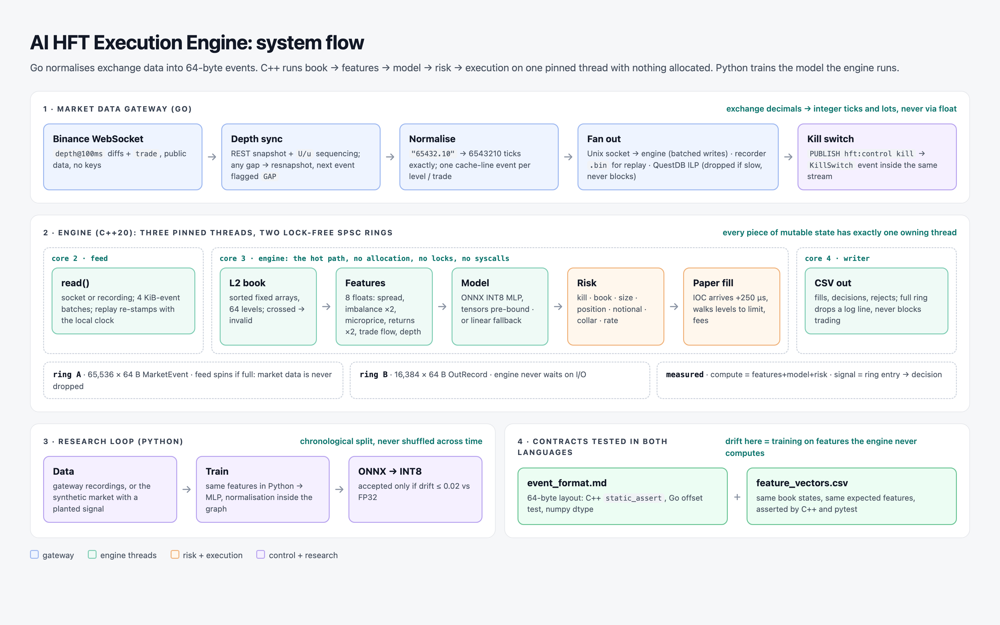
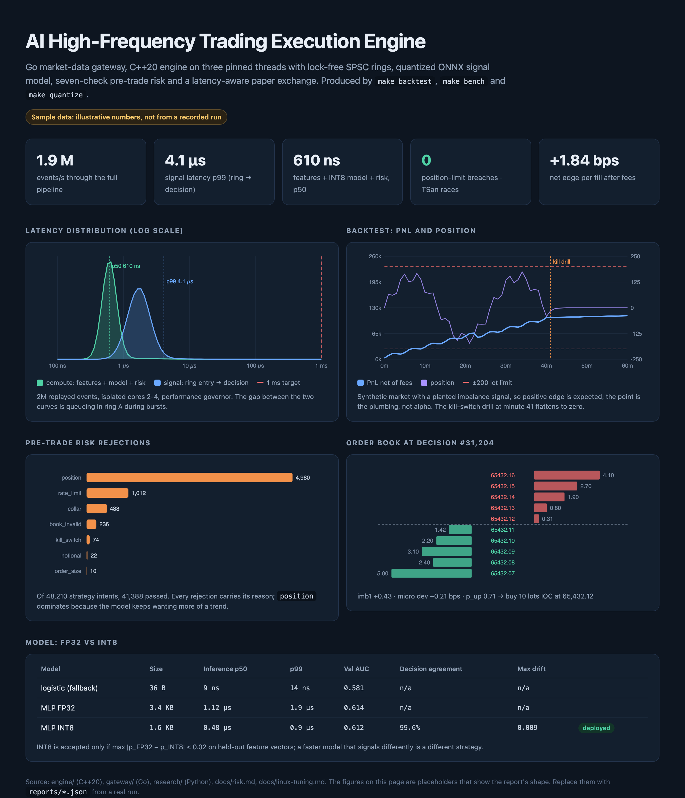

# AI High-Frequency Trading (HFT) Execution Engine

A low-latency paper-trading engine: live L2 order books from Binance, an ML signal evaluated in under a microsecond, seven pre-trade risk checks, and simulated execution that accounts for the time it takes an order to arrive.



> **Status:** code complete, not yet run against live data or benchmarked. The C++ unit tests pass (18 tests, 93 checks), including under ThreadSanitizer and AddressSanitizer/UBSan, with no warnings at `-Wall -Wextra -Wpedantic -Wshadow`. The Go gateway passes vet and `-race` tests, and the Python parity tests pass. The engine binary and benchmark compile but haven't been executed. The dashboard numbers are mock-ups. `make backtest`, `make bench` and `make quantize` produce the real ones.

## Three languages, one contract

| Part | Language | Job |
|---|---|---|
| `gateway/` | Go | Binance WebSocket → depth sync → exact decimal → 64-byte events → Unix socket, recorder, QuestDB; Redis kill switch |
| `engine/` | C++20 | book → features → model → strategy → risk → paper exchange, on pinned threads with lock-free rings |
| `research/` | Python | synthetic market, dataset, PyTorch MLP → ONNX → INT8, backtest report |

They share two files, both tested from more than one language:
- [`shared/event_format.md`](shared/event_format.md): the 64-byte event layout (C++ `static_assert`, Go offset test, numpy dtype).
- [`shared/feature_vectors.csv`](shared/feature_vectors.csv): book states with expected features, asserted by both the C++ tests and pytest. If the training features and the engine's features drift apart, the model is trading on numbers it never saw.

## The engine

```
core 2  feed    read() socket/recording ──► ring A (65,536 × 64 B) ──┐
core 3  engine  book → features → model → strategy → risk → paper fill ──► ring B (16,384 × 64 B)
core 4  writer  ring B ──► fills.csv / decisions.csv
```

- **No allocation on the hot path.** The book is two sorted fixed arrays (64 levels). Feature history is fixed rings. ONNX input and output tensors are bound once at startup. The paper exchange's pending orders sit in a fixed ring.
- **No locks.** Every piece of mutable trading state is owned by the engine thread. The only things crossing threads are two SPSC rings with cache-line-separated indices and cached peer indices. There's no second thread that can see an order, so order placement can't race. The ring is tested with 2M items across two threads under TSan.
- **Integers for money.** Prices are ticks and quantities are lots, end to end. The gateway parses `"65432.10"` straight to `6543210` without a float.
- **Honest execution.** An IOC arrives `latency_us` of market time after the decision and fills against the book *as it is then*, walking levels up to its limit. Filling at the touch you saw would hide adverse selection.
- **Gaps stop trading.** A sequence gap in the depth stream, or a consumer falling behind, sets a `GAP` flag. The engine invalidates its book and refuses to trade until the next snapshot.

## Risk

Seven checks, cheapest first, each with its own rejection counter: kill switch · book valid · order size · position · notional · price collar · rate limit (on the event clock, so replays are deterministic). The kill switch latches on drawdown or on `redis-cli PUBLISH hft:control kill`. That command arrives as an event *inside* the market-data stream, so the engine handles it in order with no extra input to poll. After that only reducing orders pass, and the engine flattens. Details: [docs/risk.md](docs/risk.md).

## Run it

```bash
make test        # C++ (18 tests) + Go (-race) + Python parity
make tsan        # C++ tests under ThreadSanitizer
make data        # 2M synthetic events with a planted imbalance signal
make train       # MLP → models/signal.onnx; logistic fallback → models/linear.txt
make quantize    # INT8, rejected if it drifts > 0.02 from FP32
make backtest    # full pipeline replay → reports/backtest.json + equity curve
make bench       # hot-path microbenchmark (pin cores first: docs/linux-tuning.md)
make live        # paper trade on Binance public data: gateway + engine + QuestDB + Redis
make kill        # trip the kill switch on a live run
```

Build with ONNX Runtime: `make build-onnx`, then `--model onnx:models/signal.int8.onnx`. Without it, the engine runs the logistic fallback.

## Targets

| | Target | Measured by |
|---|---|---|
| Throughput | > 50,000 ticks/s | `events_per_sec` in the backtest report |
| Signal latency | < 1 ms end to end | `signal_ns` p50/p99/p99.9 (ring entry → decision) |
| Hot path | sub-microsecond | `compute_ns`, `hft-bench` |
| Races in order placement | 0 | single-owner design + TSan on the ring and engine tests |
| Position limit | never breached | `max_abs_position <= position_limit` in every report |



## Choices worth defending

- **Unix socket with fixed 64-byte frames instead of ZeroMQ or gRPC.** One producer, one consumer, one machine, a fixed-size record. ZeroMQ adds a dependency and its own I/O threads for no gain, and gRPC adds protobuf encoding on the hot path. The frame layout *is* the protocol.
- **C++ for the engine, Go for the gateway.** The gateway is I/O-bound JSON over WebSockets, where Go is productive and its GC pauses don't matter, because the gateway never makes a trading decision. The engine is where pauses would matter, so it has no GC and no allocation.
- **A planted signal in the synthetic market.** It makes "the model learned something" checkable before risking anyone's time on real data. A positive backtest on synthetic data proves the plumbing, not alpha. The README and dashboard say so.

## Stretch goals

Kernel-bypass networking (Onload or DPDK) on a direct feed. FP16 and INT8 static quantization with calibration. Position sizing from signal confidence and volatility instead of a fixed clip.
